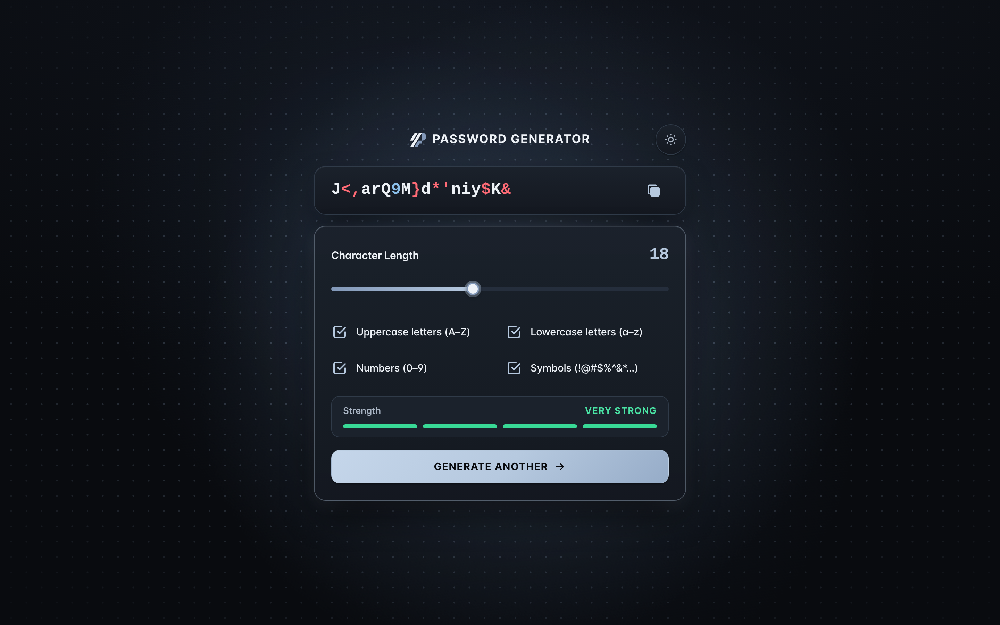
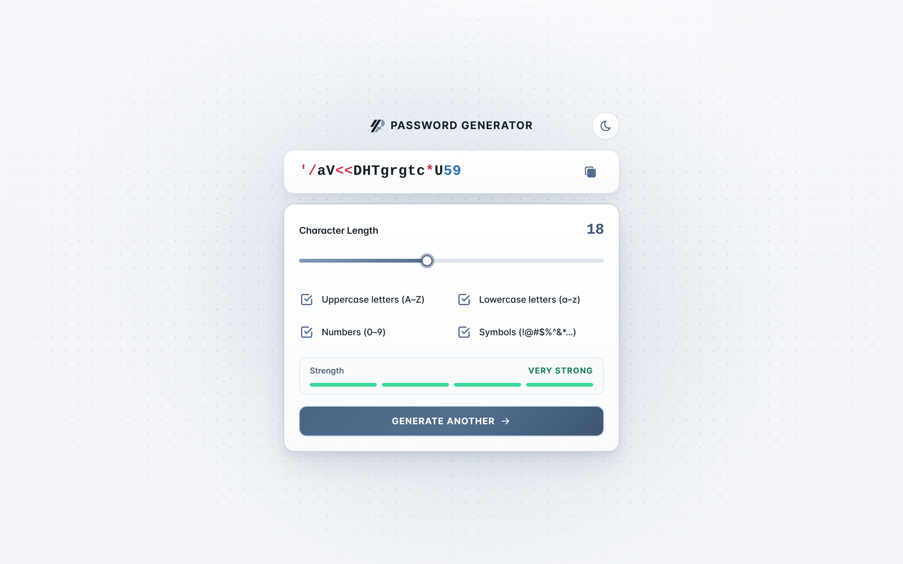
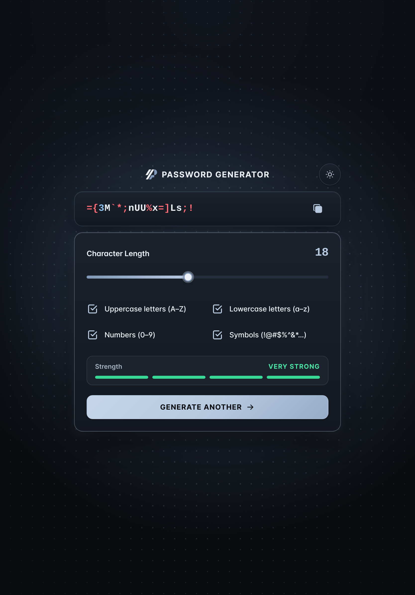
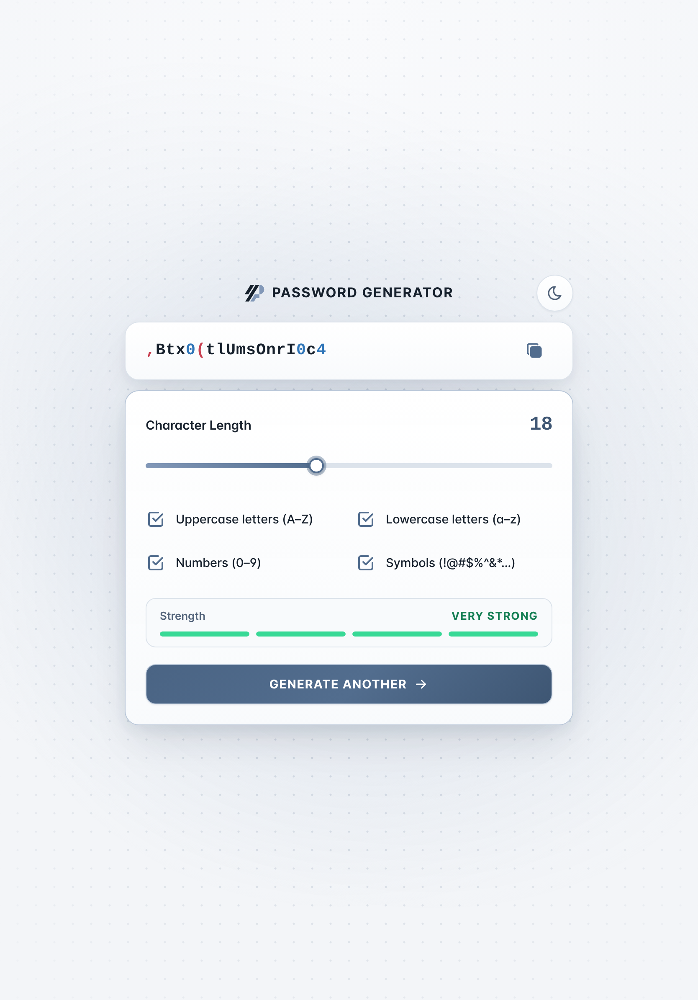
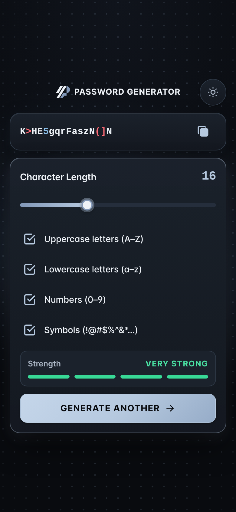
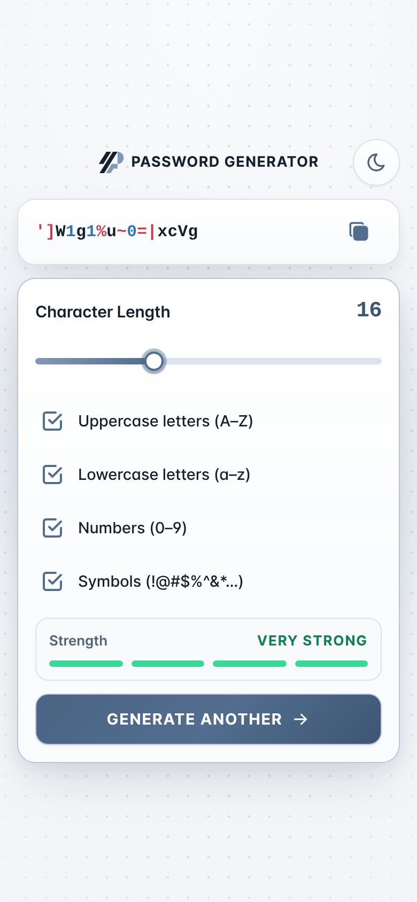

# PassFuse

A privacy-first, cryptographically secure client-side password generator built with semantic HTML5, layered CSS (`@layer`), and modular Vanilla JavaScript. Styled with the **Carbon Platinum** design system, a radially faded architectural Dot Grid, and dual-layer animated Steel-blue ambient lighting, PassFuse runs locally in the browser via the Web Crypto API (`crypto.getRandomValues`) and works both directly from disk (`file://`) and as an installable offline-capable Progressive Web App (PWA) over HTTPS.

- **Confirmed Production URL**: `https://danyalpassfusebeta.vercel.app/`

<p align="center">
  
  
</p>
<p align="center">
  
  
</p>
<p align="center">
  
  
  
  
</p>

## Key Features

- **Unbiased Cryptographic Generation**: Uses `crypto.getRandomValues` with rejection sampling for bounded integer selection (`secureRandomInt`) and uniform whole-candidate rejection sampling (`generatePassword`) so every valid category-constrained password of length $L$ has identical probability.
- **Category-Aware Character Coloring**: Displays letters, numbers, and symbols in distinct, high-contrast semantic colors while preserving the exact raw password string for one-click copying.
- **Qualitative Four-Segment Strength Indicator**: Evaluates length, enabled category diversity, and effective character-set composition across four qualitative levels (`WEAK`, `FAIR`, `STRONG`, `VERY STRONG`), starting in a neutral unclassified state (`—`) prior to generation.
- **Carbon Platinum Design System & Signature Background**: Implements dark (`#090B0F` Obsidian, `#141820` Graphite, `#1B222C` Smoked Glass, `#B6C9DF` Platinum, `#8298B8` Steel-blue) and light (`#F3F5F8` Alabaster, `#FFFFFF` Surface, `#526D8E` Platinum) themes over a steady radially faded Dot Grid and dual independently animated Steel-blue radial gradients (`32s` and `26s`) that respect `prefers-reduced-motion: reduce`.
- **Continuous Mobile & iPhone SE 2022 Viewport**: Colors both `html` and `body` with the active theme canvas, uses `100svh` (with `-webkit-fill-available` and `100vh` fallbacks; `100dvh` in standalone mode), and avoids mobile `background-attachment: fixed` on `body` so compact viewports (`375×667`) render cleanly on first paint without a bottom black strip.
- **Dual Operating Modes (`file://` and HTTPS PWA)**: Ordered classic scripts sharing `window.PasswordGen` allow `index.html` to run directly from disk via `file://` without a bundler, while HTTP/HTTPS deployments register a prefix-scoped Service Worker (`sw.js`) for full offline operation.

## Client-Side Password Generation & Security Model

### 1. Uniform Rejection Sampling (`js/random.js`, `js/generator.js`)

Let $C$ be the set of enabled character categories (`uppercase`, `lowercase`, `numbers`, `symbols`), each with disjoint character pool $P_i$, and let $P = \bigcup_{i \in C} P_i$ be the combined pool of size $N$.

1. Each character index in $[0, N)$ is drawn via `secureRandomInt(N)`, which rejects raw 32-bit unsigned values $\ge \lfloor 2^{32} / N \rfloor \times N$ to eliminate modulo bias.
2. A complete candidate of length $L$ is drawn independently and uniformly from $P^L$.
3. The candidate is accepted if and only if it contains at least one character from every enabled category $i \in C$; otherwise, the entire candidate is discarded and redrawn (up to `MAX_REJECTION_ATTEMPTS = 10000`).

### 2. Qualitative Strength Classification (`classifyStrength`)

| Qualitative Status | Active Segments | Color     | Criteria Summary                                                                 |
| :----------------- | :-------------: | :-------- | :------------------------------------------------------------------------------- |
| `WEAK`             |        1        | `#FF4D5A` | Short length ($< 10$), digits-only under $16$ chars, or single category $< 12$   |
| `FAIR`             |        2        | `#FF9F1C` | Moderate length ($10\text{–}11$ with $2+$ categories, or $12\text{–}15$ single)  |
| `STRONG`           |        3        | `#4F9DFF` | Solid length and diversity ($12\text{–}15$ with $3+$ categories, or $15+$ multi) |
| `VERY STRONG`      |        4        | `#38D996` | Long, multi-category credentials ($16+$ with $4$ categories, or $18+$ with $3+$) |

### 3. Security & Privacy Guarantees

- **Local-Only Execution**: Passwords are generated exclusively in client memory using `crypto.getRandomValues`. If Web Crypto is unavailable, generation fails explicitly rather than falling back to `Math.random()`.
- **Zero Telemetry or Password Persistence**: Generated passwords are never written to `localStorage`, `sessionStorage`, IndexedDB, cookies, console logs, or network requests. Only two non-sensitive preference keys are stored in `localStorage` when available: `pg-theme` (`"dark"` or `"light"`) and `pg-settings` (`{ length, options }`).
- **Safe DOM Updates & Strict CSP**: Password characters and status messages are rendered exclusively via `document.createElement` and `textContent` (never `innerHTML`). The production Content Security Policy (`vercel.json`) restricts `default-src`, `style-src`, `font-src`, `connect-src`, `img-src`, and `worker-src` to `'self'` plus exact SHA-256 hashes for the inline theme bootstrap and JSON-LD blocks.

## Installation, Development, Testing & Screenshot Commands

```bash
# Install dev dependencies from lockfile (Node.js >= 20; .nvmrc specifies Node 22)
npm ci

# Run unit + structural repository tests (crypto, CSP hashes, manifest, icons, SW)
npm run test:unit

# Run Playwright headless Chromium E2E, accessibility, responsive, and offline tests
npm run test:e2e

# Run full validation pipeline (ESLint + Prettier check + Unit + E2E tests)
npm run validate

# Regenerate actual application screenshots (Desktop, Tablet, Mobile, iPhone SE 2022)
npm run screenshots

# Update canonical production URL and recompute inline script SHA-256 CSP hashes
npm run set:url -- https://danyalpassfusebeta.vercel.app
```

You can also open `index.html` directly from disk (`file://`) or serve the project root with any static HTTP server (e.g., `npx serve .` or `python3 -m http.server 8080`).

## Project Structure

```text
.
├── index.html                  # Primary application shell (PASSWORD GENERATOR)
├── 404.html                    # Styled 404 error page with PF mark & theme toggle
├── manifest.webmanifest        # PWA Web App Manifest
├── sw.js                       # Prefix-scoped offline Service Worker (passfuse-classic-v6)
├── vercel.json                 # Security headers, CSP hashes, and cache-control rules
├── css/
│   ├── styles.css              # Cascade-layer (@layer) entry point
│   ├── base/                   # reset.css, variables.css, typography.css, base.css
│   ├── layout/                 # container.css, header.css
│   ├── components/             # button, card, checkbox, form, notfound, slider, strength-meter
│   └── utilities/              # animations.css, helpers.css, responsive.css
├── js/
│   ├── config.js               # Frozen character pools, bounds, and strength metadata
│   ├── random.js               # Unbiased Web Crypto rejection sampling primitives
│   ├── generator.js            # Uniform password generator & strength classifier
│   ├── theme.js                # Dark/light theme state & system preference listener
│   ├── clipboard.js            # Async Clipboard API + focus-preserving fallback
│   ├── main.js                 # UI controller, safe DOM rendering & live announcements
│   └── pwa.js                  # Progressive Service Worker registration (HTTP/HTTPS)
├── images/
│   ├── og-image.png            # 1200×630 Open Graph & Twitter/X social preview card
│   ├── apple-touch-icon.png    # 180×180 full-bleed opaque iOS Home Screen icon
│   ├── favicon.ico             # Multi-resolution browser favicon (16, 32, 48)
│   ├── favicon-{16,32,48}.png  # Raster PNG favicons
│   ├── logo-mark.svg           # Standalone PF brand mark (dark surface)
│   ├── logo-mark-light.svg     # Standalone PF brand mark (light surface)
│   ├── logo-rounded.svg        # Full-bleed square vector icon source
│   ├── logo-maskable.svg       # Vector source for maskable PWA icons (80% safe zone)
│   └── icons/app/              # PWA icons: icon-{192,512}.png & maskable-{192,512}.png
├── docs/
│   ├── architecture.md         # Architectural overview
│   └── screenshots/            # Real rendered screenshots across viewports & themes
├── scripts/
│   ├── generate-screenshots.mjs
│   └── set-production-url.mjs
└── tests/
    ├── unit.test.mjs           # Cryptographic & generator unit tests
    ├── project.test.mjs        # Repository, manifest, icon, and CSP integrity tests
    └── e2e.mjs                 # Playwright E2E, WCAG AA, motion, and viewport audit
```

## Asset Reference & Maintenance Guide

### 1. Social Preview Image (`images/og-image.png`)

- **Source path**: `images/og-image.png` (`1200 × 630` RGB PNG)
- **Public URL**: `https://danyalpassfusebeta.vercel.app/images/og-image.png?v=6`

To replace the social preview image:

1. Replace `images/og-image.png` with your updated `1200 × 630` PNG.
2. Increment `OG_IMAGE_VERSION` and synchronize metadata and CSP hashes:
   ```bash
   OG_IMAGE_VERSION=7 npm run set:url -- https://danyalpassfusebeta.vercel.app
   ```
3. Deploy to production and verify `https://danyalpassfusebeta.vercel.app/images/og-image.png?v=7` serves `Content-Type: image/png`.
4. Note that messaging platforms (iMessage, Telegram, WhatsApp, Slack, X) cache link previews by URL. Use platform cache-refresh tools (such as `@WebpageBot` on Telegram) or test with a fresh query parameter when verifying newly deployed social previews.

### 2. Apple Touch Icon (`images/apple-touch-icon.png`) & PWA Icons (`images/icons/app/`)

- **Apple touch icon**: `images/apple-touch-icon.png` (`180 × 180` full-bleed opaque RGB PNG)
- **Standard PWA icons (`purpose: "any"`)**: `images/icons/app/icon-192.png` (`192 × 192`) and `images/icons/app/icon-512.png` (`512 × 512`)
- **Maskable PWA icons (`purpose: "maskable"`)**: `images/icons/app/maskable-192.png` (`192 × 192`) and `images/icons/app/maskable-512.png` (`512 × 512`) with the PF mark centered inside the central 80% W3C safe zone.

To replace or regenerate the app icons:

1. Update the vector artwork in `images/logo-rounded.svg` (standard/Apple touch icon source) and `images/logo-maskable.svg` (maskable safe-zone source). Keep the background a full-bleed `512 × 512` opaque square without an inset border stroke or transparent pre-rounded corners so iOS and Android apply system masks without a white halo.
2. Export `images/apple-touch-icon.png` (`180×180`), `images/icons/app/icon-192.png`, `images/icons/app/icon-512.png`, `images/icons/app/maskable-192.png`, `images/icons/app/maskable-512.png`, and `images/favicon-*.png` as opaque RGB PNGs.
3. Increment the `CACHE` version constant in `sw.js` (e.g., `const CACHE = `${CACHE_PREFIX}v7`;`) so returning clients refresh precached icons, then run `npm run validate`.
4. **Already-installed Home Screen shortcuts**: iOS and Android store a local snapshot of the Home Screen icon at installation time. After deploying updated icon files, remove the existing Home Screen shortcut, reload `https://danyalpassfusebeta.vercel.app/` in the browser, and re-add it to the Home Screen.

## License & Attribution

- Source code and custom PassFuse PF brand artwork (`images/logo-*.svg`, `images/apple-touch-icon.png`, `images/icons/app/*`, `images/favicon*`, `images/og-image.png`) are licensed under the [MIT License](LICENSE) (Copyright © 2026 DanyaL NaDeri).
- Functional UI control icons (`copy`, `copy-check`, `checkbox`, `sun`, `moon`, `alert-triangle`, `arrow-right`) are inline SVGs from [Tabler Icons](https://tabler.io/icons) ([GitHub repository](https://github.com/tabler/tabler-icons)), licensed under the MIT License (Copyright © 2020–2026 Paweł Kuna).
